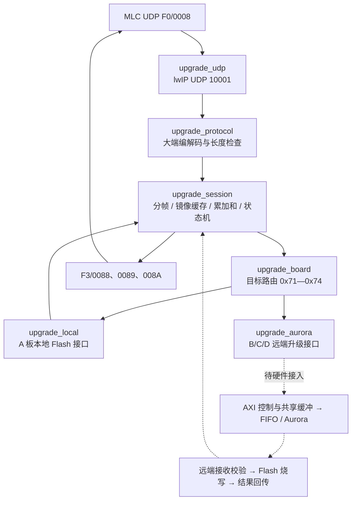

# RFAM-187 在线升级软件框架

基于用户提供的 SDK 源码，A 板 MicroBlaze 接收 MLC UDP 升级报文，统一管理 A/B/C/D 四个目标。当前交付协议层、状态机、lwIP 接入和硬件后端接口；**本地 Flash 与 AXI/Aurora 后端尚未实现，不可据此执行实际烧写**。



## 实现范围

- 0008 长度 `31+载荷长度`；0088 为 29 字节，0089/008A 为 28 字节。所有多字节整数采用大端，不带应用报文 CRC。
- 首帧只收 60 字节摘要；之后每帧载荷 1～1024 字节，序号从 1 开始；完整文件校验覆盖摘要偏移 4 到文件末尾。
- 只使用 0088 分帧应答，不另发 0001；0089 在目标准备与检查成功后发送，008A 根据实际烧写状态发送。
- 会话绑定发送端 IP/端口、UUID、模块、处理器、配置项、程序编号、总帧数；一次只升级一个目标，避免共享缓存和硬件命令交叉。
- 非连续帧回复失败和本地最近帧序号；重复帧不重复追加。完成后的最近帧重传会重发结果，不重复烧写。
- 出站报告有有界队列，发送失败保留并重试；队列压力过大时拒收新帧，不提前推进接收序号。
- 远端升级分为准备和烧写两阶段。远端准备阶段应完成传输、校验和容量预留；FIFO 空、DMA 完成或发送完成均不能代表烧写成功。
- 默认硬件后端返回失败，不写任何猜测的寄存器或地址。

## 代码入口

| 文件 | 职责 |
|---|---|
| src/upgrade_protocol.c/h | 编解码、BCD 摘要、累加和 |
| src/upgrade_session.c/h | 四目标会话状态机，纯 C、无 BSP 依赖 |
| src/upgrade_udp.c/h | lwIP 接收、pbuf 链拷贝、应答队列发送 |
| src/upgrade_board.c/h | 板级配置、目标路由、UTC 时钟接口 |
| src/upgrade_backend.h | 本地和远端后端契约 |
| src/upgrade_local.c | A 板 Flash 待实现接口 |
| src/upgrade_aurora.c | B/C/D AXI/Aurora 待实现接口 |
| docs/升级后端接口.md | 硬件接入、两阶段状态和缓存所有权 |

`src/main.c` 已加入启动和轮询调用。MicroBlaze 的 `platform.c` 定时中断增加轻量时钟计数；`platform_mb.c` 的定时周期按 BSP 100 MHz 时钟计算为 250 ms，修正原来按 66 MHz 常数计算的 165 ms 周期。

## 主机验证

```sh
make test
make check-bsp BSP_INCLUDE=/path/to/RFAM_187_XVC_bsp/microblaze_0/include
```

`make test` 启用 AddressSanitizer 和 UndefinedBehaviorSanitizer，覆盖正常升级、乱序/重传、目标隔离、校验/容量失败、后端错误、发送背压、超时及 10000 组畸形报文；另外验证所有未实现后端都不会返回成功。当前执行器不支持 LeakSanitizer，命令只关闭泄漏检测；地址与未定义行为检查保留。

`check-bsp` 使用上传的 lwIP 2.0.2/Xilinx BSP 真实头文件检查启用和禁用升级两条编译路径，测试 UUID 仅用于编译，不是实际配置。它是主机语法/API 检查，**不是 MicroBlaze 编译、链接、时序或上板测试**。

## SDK 集成与配置

1. 将 `src/upgrade_*.c/h` 加入原 SDK 应用，并合入 main/platform 的改动；使用原有 BSP 和 MicroBlaze 工具链。此仓库的 Makefile 只负责主机测试。
2. 在 `upgrade_board.h` 设置真实的 `UP_BOARD_UUID`、`UP_BOARD_MODULE`，核实每个目标的配置项及程序编号；B/C/D 映射默认未知而禁用，不借用 A 的编号。A 的默认映射来自协议附录，仍需与产品配置核实。
3. 实现并验证本地 Flash / 远端 AXI/Aurora 后端，补充 UTC 时间源。当前没有 UTC 源时报告时间戳为零；报告流水号采用本机递增 1～65535 的实现约定。
4. 核对 `UP_BOARD_IMAGE_CAPACITY`（默认 32 MiB）及链接 map，确保专用 BSS 缓冲位于 DDR 且不与共享区、DMA 或其他使用者冲突。它不等于已确认的 Flash 容量。AXI 硬件使用前需要处理地址对齐、缓存一致性与所有权。
5. 设置 `UP_BOARD_ENABLED=1`。默认关闭以避免使用未知 UUID/MARK。开启后 main 使用 `172.16.10.157/24`、网关 0（同网段），不启动 DHCP；保留 BSP 内 DHCP 支持。MLC 源端口要求为 10000，报告发回实际来源 IP 的该端口。网段/网关可在板级配置中调整。
6. 当前 XVC 代码保留；升级测试期间不应并行运行 XVC 编程。接收回调只处理数据，耗时硬件步骤必须每次及时返回，让 lwIP 主循环继续运行。

## 当前采用的实现策略

以下是补充实现策略，不宣称 ICD 已明确规定：接收/终态保留超时 30 秒；准备和烧写各限时 120 秒；未知/未启用目标或无法可靠解码的报文直接丢弃；只有完整可解析的升级消息参与 0088 应答。硬件未实现等未定义故障返回 0089 失败、保留故障码 0；没有虚构新错误码。

32 位整文件校验字使用 64 位临时变量求精确字节和，超过 `UINT32_MAX` 视为校验失败，尚未擅自采用模 2^32 截断。该行为需在大镜像联调时与 MLC 确认。摘要采用有效 BCD 日期，文件长度不能为零。

当前先把完整文件接收到 A 板 DDR，再执行目标准备；不是跨 UDP/Aurora 的逐帧实时转发。此策略适用于现有 512 MiB DDR，但镜像必须不超过配置的暂存上限。跨掉电恢复、双镜像回滚、自动复位/重配置及固件签名不是本版已经实现的功能。

Flash 芯片手册与分区定义后续补充。架构说明中的硬件接口不等于已实现的驱动。
